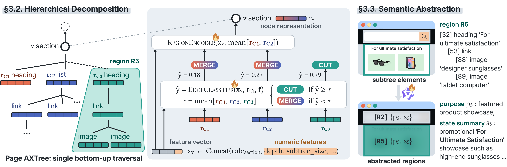
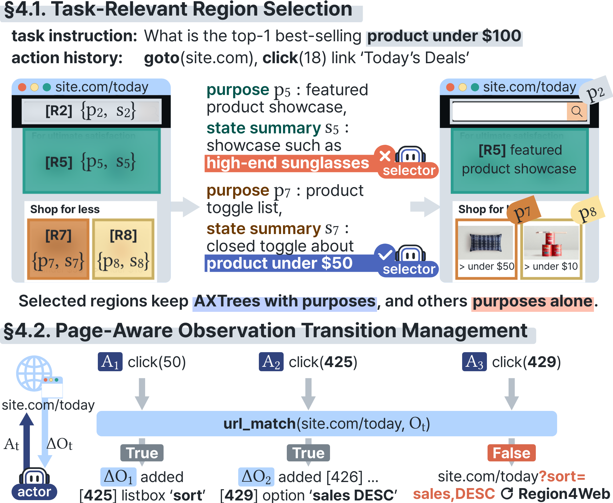

# Region4Web: Rethinking Observation Space Granularity for Web Agents

Web agents usually observe a page at the same element-level granularity as their action space. Region4Web instead organizes the page's AXTree into **functional regions**, groups of elements that collectively serve a shared purpose, and PageDigest delivers this region-level observation to the actor agent as a compact per-page digest.

## Region4Web

<p align="center"></p>

Region4Web constructs region-level observation from the AXTree in two stages.

- **Hierarchical decomposition** (`framework/decomposition/`). A single bottom-up traversal classifies every parent-child edge as merge or cut. `RegionEncoder` builds each node's representation from its merged children, and `EdgeClassifier` scores each child edge against the sibling mean (cut if the score ≥ τ = 0.55). The subtrees left after removing cut edges are the functional regions.
- **Semantic abstraction** (`framework/abstraction/`). A fine-tuned Qwen3-0.6B reads each region's AXTree subtree and produces a **purpose** (what the region is for) and a **state summary** (its current content and available actions).

The trained models are in `region4web/`:

| File | Model |
|---|---|
| `region4web/decomposition.pt` | Decomposition model (RegionEncoder + EdgeClassifier, ~536K parameters) |
| `region4web/abstraction/` | Abstraction model (Qwen3-0.6B, full fine-tuning), stored with Git LFS |

## PageDigest

<p align="center"></p>

PageDigest (`pipeline/`) is an inference pipeline that shares the actor agent's backbone LLM and operates only on the observation space.

- **Task-relevant region selection** (`pipeline/selection/`). On entering a new page, the backbone selects task-relevant regions from the region abstractions, the task instruction, and the action history. Selected regions are shown with their AXTree subtrees and purposes, and the other regions with their purposes only.
- **Page-aware observation transition management** (`pipeline/transition.py`, `pipeline/manager.py`). Within the same page, the observation is updated by comparing the current AXTree with its state at page entry instead of re-running Region4Web. Added nodes are listed in a separate block. A URL change triggers Region4Web and selection on the new page.
- **`view_all()`**. The actor can call this action to expose every region's full subtree for the rest of the page when the selected regions are insufficient.

## Setup

```bash
git lfs install && git lfs pull        # fetch region4web/abstraction/model.safetensors
pip install -e .
pip install -r requirements.txt
playwright install chromium
cp secrets.yaml.example secrets.yaml   # API keys for the backbone and annotator LLMs
```

Set your WebArena URLs in `config.yaml` under `benchmark.webarena.urls`. Map tasks use the live OpenStreetMap service by default.

## Inference

The runner evaluates WebArena tasks in one of two observation modes.

| `--mode` | Observation given to the actor |
|---|---|
| `backbone` | Full AXTree at every step (baseline) |
| `pagedigest` | Region4Web + PageDigest |

```bash
# PageDigest with GPT-5.1 on all 812 WebArena tasks
python -m benchmarks.runner --backbone gpt-5.1 --mode pagedigest \
    --task-list benchmarks/task_lists/full.txt

# Backbone-only baseline
python -m benchmarks.runner --backbone gpt-5.1 --mode backbone \
    --task-list benchmarks/task_lists/full.txt

# One runner per site in parallel (shopping, shopping_admin, reddit, gitlab, map)
python -m benchmarks.run_parallel --backbone gpt-5.1 --mode pagedigest \
    --task-list benchmarks/task_lists/full.txt
```

- `benchmarks/task_lists/lite.txt` runs the 165-task WebArena-Lite subset, and `--task-slice 0:10` runs part of a list.
- `--backbone <name>` merges `configs/<name>.yaml` into `config.yaml`. Model names with the `openai/`, `anthropic/`, `deepseek/`, or `gemini/` prefix call the provider API, and other names (e.g., `Qwen/Qwen3.5-27B`) call an OpenAI-compatible vLLM server at `benchmark.llm.base_url`.
- With `run_parallel` in `pagedigest` mode, the number of parallel runners is capped at the number of visible GPUs, since each runner loads the Region4Web models.

Each task writes to `results/webarena/<backbone>/base/<mode>/<task_id>/`:

| File | Content |
|---|---|
| `summary.json` | Success, final answer, steps, token usage and cost |
| `trajectory.jsonl` | Per-step action and timing |
| `axtrees.jsonl` | Serialized AXTree per step |
| `decompositions.jsonl`, `abstractions.jsonl`, `selections.jsonl` | Region4Web and selection outputs per page entry |
| `transitions.jsonl` | Within-page observation changes |
| `actor_calls.jsonl` | Full actor prompt and output per step |

## Training

### Data annotation

Training data is annotated by gpt-5-mini through the OpenAI Batch API. The source pages' AXTrees are read from `data/axtrees/`. Each `generate_*` script writes a batch request file to `data/api_requests/`. Submit it with `batch_api.py upload` and fetch the results with `batch_api.py download` before running the next script.

```bash
# 1. Decomposition: region root IDs per page, then re-partition oversized regions (fallback)
python training/data_generation/generate_decomposition_data.py --mode batch
python training/data_generation/generate_decomposition_fallback.py
python training/data_generation/build_decomposition_annotations.py \
    --fallback-output data/api_requests/decomposition_fallback_output.jsonl

# 2. Verification: keep pages whose partition has no invalid region
python training/data_generation/generate_verification_data.py
python training/data_generation/build_verification_annotations.py

# 3. Abstraction: purpose and state summary per verified region
python training/data_generation/generate_abstraction_data.py
python training/data_generation/build_abstraction_annotations.py

# 4. Final training files: data/decomposition.jsonl, data/abstraction.jsonl
python training/data_generation/build_training_data.py
```

```bash
# Batch API helper (split / upload / status / download / cancel)
python training/data_generation/batch_api.py upload   --input data/api_requests/decomposition_input.jsonl
python training/data_generation/batch_api.py download --input data/api_requests/decomposition_input.jsonl
```

### Model training

```bash
# Decomposition model: teacher forcing on cut/merge edge labels, focal loss (α = 0.75, γ = 2.0)
python -m training.train_decomposition --config config.yaml

# Abstraction model: full fine-tuning of Qwen3-0.6B with DDP (effective batch size 48)
torchrun --nproc_per_node=3 training/train_abstraction.py --config config.yaml
```

Checkpoints are written to `checkpoints/`. Hyperparameters are set under `training` in `config.yaml`. To use a newly trained model, point `framework.decomposition.checkpoint_path` or `framework.abstraction.checkpoint_path` to it.
