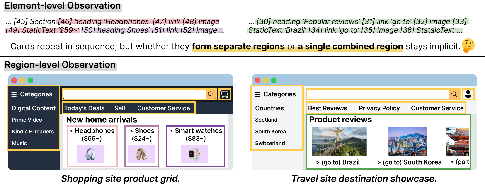
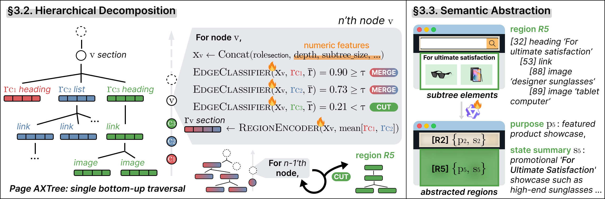
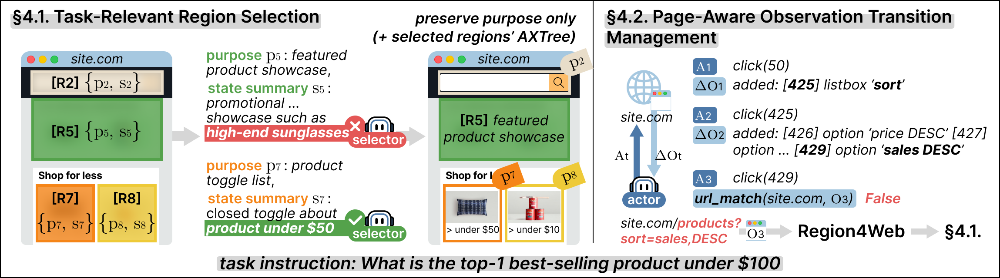

# Region4Web: Rethinking Observation Space Granularity for Web Agents

Region4Web reorganizes a page's AXTree into functional regions through hierarchical decomposition and semantic abstraction. PageDigest delivers this region-level observation to the actor agent as a compact per-page digest that persists across steps.

<p align="center"></p>

**Region4Web.** A single bottom-up traversal classifies each parent-child edge as merge or cut, and each resulting region is summarized by its purpose and state summary.

<p align="center"></p>

**PageDigest.** On page entry, the backbone LLM selects task-relevant regions. Within the page, only observation transitions are tracked.

<p align="center"></p>

## Setup

```bash
pip install -e .
pip install -r requirements.txt
playwright install chromium
cp secrets.yaml.example secrets.yaml   # add your API keys
```

Set your WebArena URLs in `config.yaml` (`benchmark.webarena.urls`).

The decomposition checkpoint is included at `checkpoints/decomposition/run_001/epoch_125.pt`. Place the abstraction checkpoint at `checkpoints/abstraction/run_001/step_65350/`.

## Inference

```bash
# PageDigest
python -m benchmarks.runner --backbone gpt-5.1 --mode pagedigest --task-list benchmarks/task_lists/full.txt

# Backbone only
python -m benchmarks.runner --backbone gpt-5.1 --mode backbone --task-list benchmarks/task_lists/full.txt
```

Use `benchmarks/task_lists/lite.txt` for WebArena-Lite. Trajectories are saved under `results/`.

## Training

Training data is annotated with gpt-5-mini from source-page AXTrees in `data/axtrees/`. Each `generate_*` step writes an OpenAI Batch API request file. Submit it with `batch_api.py upload` and fetch results with `batch_api.py download` before the next step.

```bash
python training/data_generation/generate_decomposition_data.py --mode batch
python training/data_generation/generate_decomposition_fallback.py
python training/data_generation/build_decomposition_annotations.py \
    --fallback-output data/api_requests/decomposition_fallback_output.jsonl
python training/data_generation/generate_verification_data.py
python training/data_generation/build_verification_annotations.py
python training/data_generation/generate_abstraction_data.py
python training/data_generation/build_abstraction_annotations.py
python training/data_generation/build_training_data.py
```

```bash
python -m training.train_decomposition --config config.yaml
torchrun --nproc_per_node=3 training/train_abstraction.py --config config.yaml
```
